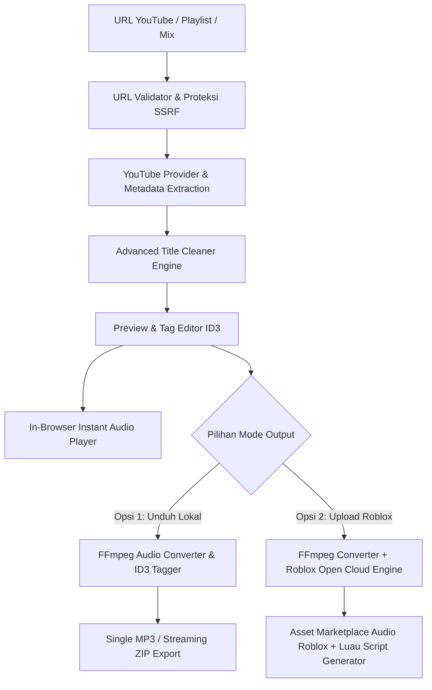

# Maxistrong — YouTube Downloader & Roblox Audio Sync

Sistem ini berfungsi untuk:
- **Mengunduh & Mengonversi Audio**: Mengonversi lagu tunggal, playlist, maupun YouTube Mix ke berkas MP3 berkualitas tinggi (hingga 320 kbps) atau format audio asli, baik sebagai berkas individu maupun arsip streaming ZIP.
- **Pembersihan Judul Otomatis**: Mendeteksi dan menghapus teks promosi, kata viral, dan tag teknis dari judul YouTube, serta mengekstrak nama artis dan komposer (`Cipt: ...`) secara akurat.
- **Preview Audio Instan di Web**: Memutar lagu langsung di peramban sebelum mengunduh atau mengunggah ke Roblox.
- **Sinkronisasi Pitch & Kecepatan untuk Roblox**: Mengubah tempo/pitch audio dan menghasilkan kode skrip Luau otomatis untuk menormalkan kembali audio di Roblox Studio.
- **Upload Langsung ke Roblox**: Mengirim aset audio langsung ke inventaris Roblox Open Cloud (User atau Group) tanpa perlu disimpan ke komputer lokal terlebih dahulu.

---

## Arsitektur Alur Kerja Sistem



---

## Fitur & Kegunaan Utama

### 1. Advanced Title Cleaner Engine
Sistem pembersih judul cerdas berbasis kamus kontekstual dan regular expression yang dirancang khusus untuk membersihkan judul lagu dari spam promosi YouTube tanpa menghilangkan identitas karya:
- **Pembersihan Kata Promosi**: Menghapus pola teks promosi seperti `FULL ALBUM`, `VIRAL TIKTOK`, `LAGU TERBARU 2026`, `HQ AUDIO`, `OFFICIAL VIDEO`, `KOPLO TERBARU`, dan sejenisnya.
- **Preservasi Versi Asli**: Mempertahankan keterangan versi lagu yang sesungguhnya, seperti `(Remix)`, `(Slowed)`, `(Speed Up)`, `(Live Performance)`, `(Acoustic)`, dan `(Cover)`.
- **Ekstraksi Komposer & Pencipta Lagu**: Mendeteksi pola kredit seperti `(Cipt: ...)` atau `Ciptaan: ...` dan memindahkannya ke kolom metadata komposer yang tepat agar judul lagu tetap ringkas dan bersih.
- **Normalisasi Format**: Menyeragamkan format judul menjadi `Artis - Judul Lagu` yang valid untuk sistem berkas (tanpa karakter terlarang seperti `/`, `\`, `:`, `*`, `?`, `"`, `<`, `>`, `|`).

### 2. Normalisasi Pitch & Sinkronisasi Audio Roblox
Fitur yang dirancang khusus untuk mempermudah creator game Roblox:
- **Preset Rasio Kecepatan**: Pilihan penyesuaian kecepatan dan pitch audio (0.80x Slowed, 0.90x, 1.00x Normal, 1.10x, 1.20x Speed Up, dan semitone shift).
- **Generator Skrip Luau Otomatis**: Menghasilkan kode pemrograman Luau satu-klik yang siap ditempelkan ke objek `Sound` di Roblox Studio untuk menormalkan kembali audio yang telah di-pitch:
```lua
local SoundService = game:GetService("SoundService")
local sound = Instance.new("Sound")
sound.SoundId = "rbxassetid://ASSET_ID"
sound.PlaybackSpeed = 1.0
sound.Parent = workspace
sound:Play()
```

### 3. Integrasi Langsung Roblox Open Cloud API
Selain mengunduh audio ke komputer lokal, pengguna dapat memilih mode pengunggahan langsung ke Roblox tanpa memakan ruang penyimpanan lokal:
- Menggunakan endpoint resmi `https://apis.roblox.com/assets/v1/assets`.
- Mendukung autentikasi API Key Roblox dengan Creator ID berbasis akun pengguna (*User*) maupun grup (*Group*).
- Status operasi asinkron dipantau secara otomatis hingga aset audio berstatus `Success` dan menghasilkan Asset ID resmi.

### 4. Pemutar Preview Audio Instan di Web
- Mendengarkan audio lagu langsung dari browser sebelum memutuskan untuk mengunduh atau mengunggah ke Roblox.
- Dilengkapi dengan slider waktu presisi, pengatur volume, dan selector kecepatan putar *real-time* untuk menguji kecocokan tempo audio secara interaktif.

### 5. Editor Metadata ID3 Tagging
- Penyuntingan metadata audio (Judul, Artis, Album, Tahun Rilis) sebelum proses konversi dijalankan.
- Mendukung pengeditan massal (*Batch ID3 Editor*) untuk satu playlist sekaligus, maupun pengeditan mendetail untuk tiap trek individu.
- Metadata disimpan secara permanen ke dalam tag ID3v2 pada berkas audio MP3 hasil keluaran FFmpeg.

### 6. Job Queue & Real-Time Progress Stream
- Manajemen antrean unduhan berbasis proses modular di backend.
- Komunikasi status waktu nyata menggunakan Server-Sent Events (SSE) pada endpoint `/api/jobs/:jobId/events`.
- Pengemasan berkas playlist secara asinkron menjadi satu arsip ZIP menggunakan streaming buffer tanpa membebani memori RAM server.

### 7. Keamanan & Proteksi SSRF
- Validasi ketat pada setiap URL masukan dengan pemblokiran terhadap alamat IP internal/privat (`127.0.0.1`, `localhost`, `169.254.169.254`, dsb.).
- Perlindungan dari eksploitasi Server-Side Request Forgery (SSRF).
- Pembatasan laju permintaan (*Rate Limiting*) untuk menjamin stabilitas layanan backend.

---

## Spesifikasi Teknis

| Komponen | Teknologi |
| :--- | :--- |
| **Backend Language** | TypeScript (Node.js runtime via `tsx`) |
| **Backend Framework** | Express.js |
| **Frontend Framework** | Next.js 16 (App Router, Static Export) |
| **Client Library** | React 19, Lucide Icons |
| **Media Processing** | FFmpeg, yt-dlp, Node-ID3, Archiver |
| **Cloud Integration** | Roblox Open Cloud Assets API v1 |
| **Testing** | Node.js Test Runner (`tsx --test`) |

---

## Panduan Pemasangan & Menjalankan Lokal

### 1. Prasyarat Sistem
- Node.js versi 20 atau versi 22+
- FFmpeg (tersedia di PATH sistem atau berada di dalam folder `backend/`)
- yt-dlp (tersedia di PATH sistem atau berada di dalam folder `backend/`)
- Python 3

#### Cara Cepat Memasang FFmpeg & yt-dlp via Terminal:
```powershell
pip install yt-dlp
pip install ffmpeg-downloader
ffdl install
```

### 2. Kloning & Instalasi Dependensi

```bash
git clone https://github.com/oyy-gus/yt-downloader.git
cd yt-downloader
```

Instal dependensi Backend:
```bash
cd backend
npm install
```

Instal dependensi Frontend:
```bash
cd ../frontend
npm install
```

### 3. Konfigurasi Lingkungan (`.env`)

Buat berkas `.env` di dalam direktori `backend/`:
```env
PORT=5000
NODE_ENV=development
FRONTEND_URL=http://localhost:3000
TEMP_DIR=./tmp
MAX_CONCURRENT_JOBS=3
MAX_PLAYLIST_ENTRIES=50
MAX_PROCESSING_DURATION_SEC=600
TEMP_FILE_EXPIRATION_HOURS=2
LOG_LEVEL=info
DEV_MOCK_MODE=false
```

*(Opsional)* Letakkan berkas `cookies.txt` dari YouTube di dalam direktori `backend/` untuk memastikan akses stream terlindungi dari verifikasi bot.

### 4. Menjalankan Server Pengembangan

**Terminal 1 — Backend:**
```bash
cd backend
npm start
```
Server backend aktif di `http://localhost:5000`.

**Terminal 2 — Frontend:**
```bash
cd frontend
npm run dev
```
Aplikasi web dapat diakses melalui browser di `http://localhost:3000`.

---

## Referensi API Backend

| Metode | Endpoint | Fungsi |
| :--- | :--- | :--- |
| `GET` | `/api/health` | Pemeriksaan kesehatan server backend |
| `POST` | `/api/analyze` | Menganalisis URL, mengambil entri playlist/track, dan menerapkan cleaner |
| `POST` | `/api/jobs` | Membuat tugas pemrosesan unduhan audio atau upload Roblox |
| `GET` | `/api/jobs/:jobId` | Mengambil status dan detail kemajuan antrean pekerjaan |
| `GET` | `/api/jobs/:jobId/events` | Stream pembaruan kemajuan berbasis Server-Sent Events (SSE) |
| `POST` | `/api/jobs/:jobId/cancel` | Membatalkan pekerjaan yang sedang berjalan |
| `GET` | `/api/files/:jobId/zip` | Mengunduh seluruh berkas playlist dalam satu arsip ZIP |
| `GET` | `/api/files/:jobId/track/:trackId` | Mengunduh satu berkas MP3 tertentu |
| `POST` | `/api/roblox/validate` | Memvalidasi kredensial API Key dan Creator ID Roblox Open Cloud |
| `POST` | `/api/roblox/upload` | Mengunggah berkas audio secara manual ke Roblox Open Cloud |

---

## Panduan Deployment Tunggal (Single-Host Container)

Aplikasi ini mendukung deployment satu kontainer penuh yang menggabungkan hasil build statis frontend dan server backend menggunakan Dockerfile multi-stage.

### Menjalankan Kontainer Docker Lokal:
```bash
docker build -t maxistrong-app .
docker run -p 5000:5000 maxistrong-app
```
Akses aplikasi melalui `http://localhost:5000`.

### Panduan Deploy ke Platform Cloud (Koyeb / Render / VPS):
1. Hubungkan repositori GitHub ke penyedia layanan cloud.
2. Pilih tipe build **Dockerfile**.
3. Arahkan path Dockerfile ke `Dockerfile` di root direktori.
4. Tetapkan variabel lingkungan `PORT=5000` dan `NODE_ENV=production`.
5. Buka port `5000` untuk melayani antarmuka web dan API dalam satu domain yang sama tanpa kendala CORS.

---

## Pengujian Sistem

Seluruh unit test mencakup pengujian Title Cleaner Engine, pembuat ID3 Tag, pemrosesan metadata antrean kerja, dan URL validator:

```bash
cd backend
npm test
```
